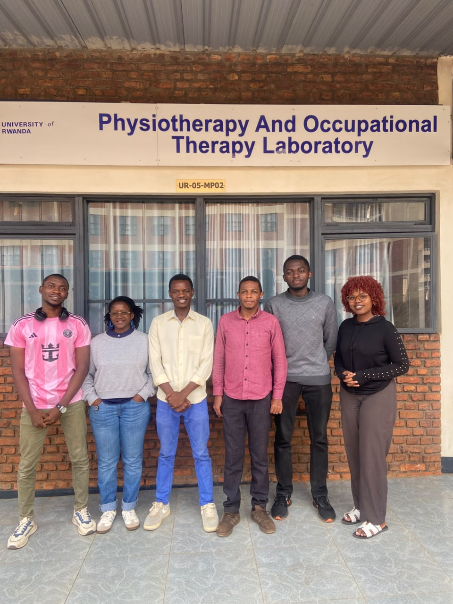

I am participating in a hackathon hosted by the **Centre for Digital Language Inclusion (CDLI)**, building **Speech Assist**—an end-to-end assistive communication platform engineered for individuals with speech and motor impairments in Rwanda.

<figure style="float:right; margin: 0 0 1em 1.5em; max-width: 340px;">
  
  <figcaption style="font-size:0.85em; color:#555; margin-top:6px; text-align:center;">Our design team at a meetup with two participants living with speech impairments, University of Rwanda.</figcaption>
</figure>

### Real-World Problem & Context
People living with speech impairments—including individuals with cerebral palsy, Parkinson's disease, multiple sclerosis, stroke-induced dysarthria, and stuttering—frequently face severe barriers when communicating with strangers, healthcare workers, teachers, and vendors. 

In Rwanda, **rural internet penetration is roughly 19%**, meaning standard cloud-based speech APIs (Google Cloud Speech, Whisper API) are fundamentally unusable for everyday life. Furthermore, privacy demands that vulnerable users' voice recordings never leave their physical hardware. Therefore, the system must run **100% offline on low-cost Android smartphones**, requiring rigorous model compression, low memory footprints, and low inference latency.

### What I Implemented

1. **ASR Model Fine-Tuning on Non-Standard Bantu Speech**:
   - Fine-tuned bilingual ASR foundation models across multiple architectures: **Whisper-small**, **Whisper Large-v3**, **Omnilingual CTC-300M**, and streaming **Zipformer** (Sherpa-ONNX).
   - Trained on the landmark CDLI impaired speech corpora:
     - **61.7 hours of impaired Kinyarwanda** from 61 speakers (mostly stuttering and articulation disorders).
     - **44.4 hours of non-standard Rwandan-accented English** from 59 speakers (covering cerebral palsy, stroke, Parkinson's, and dysarthria).
   - Pre-trained base models leveraging an aggregated corpus of **3,490+ hours of clean and accented speech** (Common Voice + AfriVoice) before target fine-tuning on impaired speech.
   - Achieved state-of-the-art **0.374 Word Error Rate (WER)** on Kinyarwanda impaired speech (our E18 checkpoint)—the best published mark on Bantu impaired speech to date—and 0.266 WER on Rwandan-accented English.

2. **On-Device 4-Bit Quantization (`whisper.cpp` / GGML / Sherpa-ONNX)**:
   - Compressed the fine-tuned Whisper-small model from FP32 down to 4-bit (`Q4_K` precision) via **`whisper.cpp`** and **GGML**, shrinking total model weight size down to **145 MB**.
   - Profiled and benchmarked execution speed across real hardware (e.g., Samsung Galaxy Note10 and entry-level target devices), achieving on-device inference latency of ~9 seconds for an entire 19-second utterance fully offline without GPU acceleration.
   - Built a Sherpa-ONNX pipeline with streaming Zipformer models for instant, ultra-low latency chunk-by-chunk transcription.

3. **End-to-End Flutter Assistive Mobile Application**:
   - Engineered the mobile frontend in **Flutter / Dart** backed by native C++ bindings (Android NDK) for real-time offline ASR execution.
   - Built a custom **language model post-processing and autocorrect pipeline**, fine-tuned on Kinyarwanda health, legal gazette, and translation corpora to resolve phonetic ambiguities in dysarthric speech.
   - Designed an accessible user experience: high-contrast styling, large touch surfaces for users with spasticity or motor tremors, minimal cognitive load, and bilingual interface toggling.
   - Integrated **Kinya-Flex Text-to-Speech (TTS)** voice synthesis to speak transcribed sentences out loud clearly, bridging the gap between impaired speakers and their conversation partners.

4. **Continuous Field Evaluation & Scoring Portal**:
   - Developed and deployed an automated evaluation portal (`recording_portal`) to upload, transcribe, score, and rank 12 candidate acoustic models against field recordings from clinics and community partners.

### Technologies & Tools Used
* **Languages**: Python, C++, Dart, Bash, SQL
* **Speech & Deep Learning**: PyTorch, OpenAI Whisper, `whisper.cpp`, GGML, Hugging Face Transformers, Omnilingual ASR, Sherpa-ONNX / Zipformer, KenLM
* **Mobile & Systems**: Flutter, Android NDK, Dart FFI, Linux, On-Device Profiling
* **Infrastructure & Data**: Common Voice, AfriVoice, CDLI Non-Standard Datasets, Weights & Biases (W&B), Marimo notebooks
